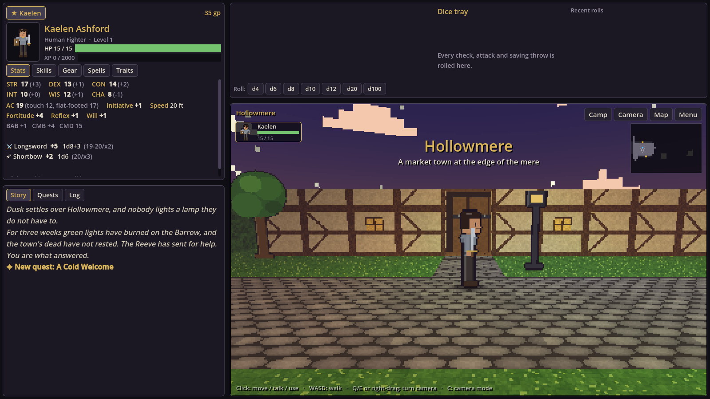
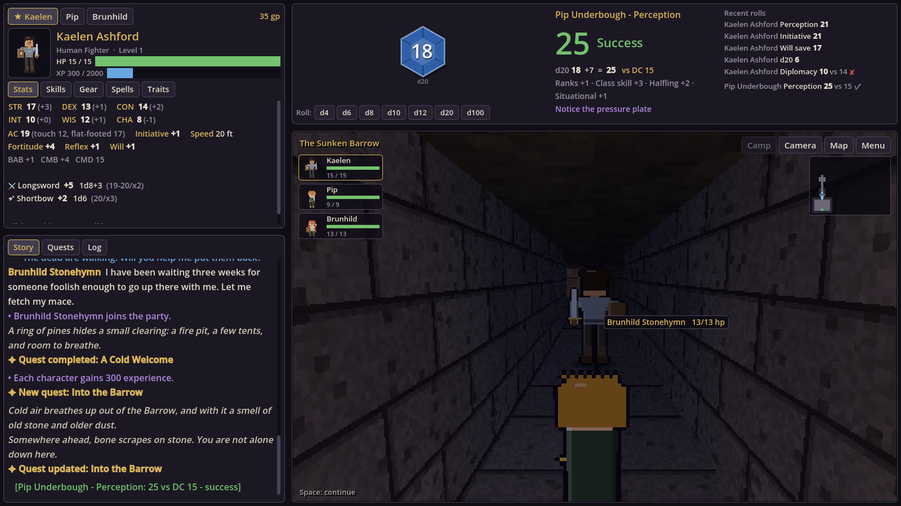
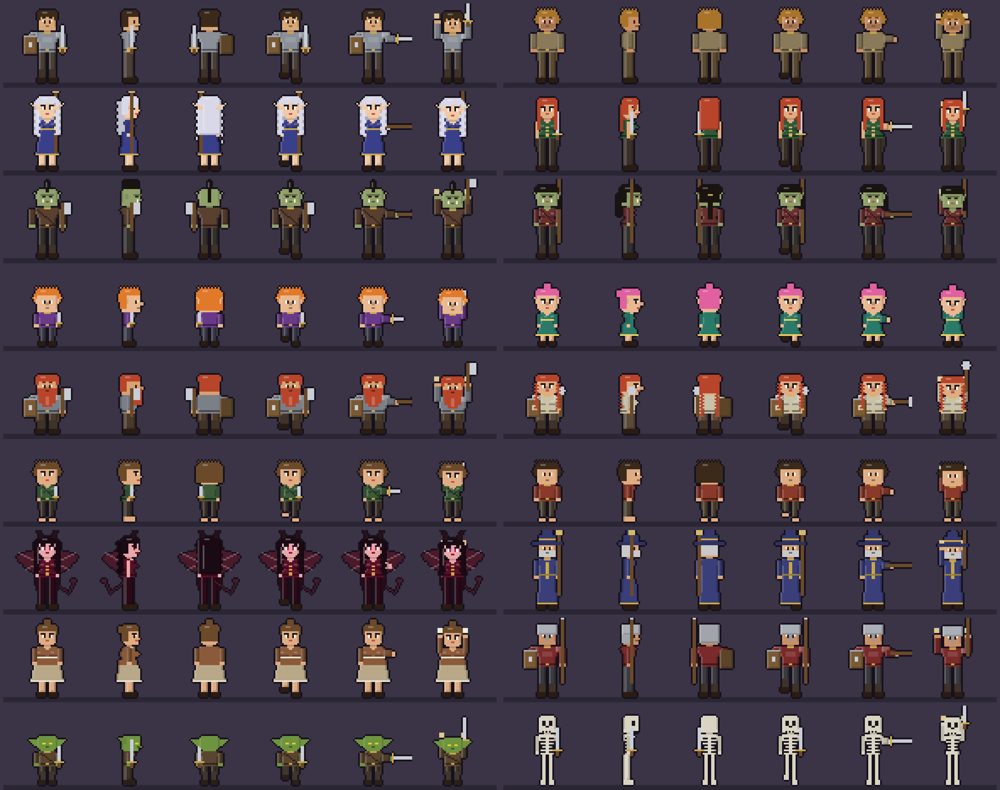

# OpenGate

An open framework for building and playing Baldur's-Gate-style RPGs with the **Pathfinder (1st edition)**
rules. The computer is the Game Master; you play solo with a party of companions.

Built with Godot 4 (GDScript). Runs on Linux. No art or audio files are required: rooms, textures,
characters and sound effects are generated in code, and ElevenLabs can add voices, music and portraits.



## Play

```bash
./run.sh
```

`./run.sh --windowed` runs in a window. F11 toggles fullscreen. You need Godot 4.7+ on your PATH
(`sudo pacman -S godot` on Arch/Omarchy).

## The screen

| | |
|---|---|
| **Top left: character sheet** - stats, skills, gear, spells, traits. Click gold names to roll them. | **Top right: dice tray** - every d20, check, attack and damage roll is animated here with its full breakdown. |
| **Bottom left: journal** - the story, your dialogue choices (with skill checks), quests, and the log. | **Bottom right: the world** - a retro 3D view of the room built from a 2D map, with animated 2D sprites. |

## Controls

| | |
|---|---|
| Left click | walk there / talk / use / open door / pick a combat target |
| W A S D | walk (relative to the camera) |
| Q, E or right-drag | turn the camera (switches to the chase camera) |
| C | switch between room camera and chase camera |
| 1-9 | pick a dialogue choice |
| Space / Enter | hurry text and dice along; end your turn in combat |
| G | go to camp / leave camp (rest at the campfire) |
| M or Tab | bigger minimap (click it to walk, or to pick a tile or enemy in combat when sprites overlap) |
| Esc | menu (save, load, settings); skip a cutscene; cancel spell targeting |
| F5 / F9 | quick save / quick load |

## What is in the box

- **Rules engine**: abilities, races, classes (fighter, rogue, cleric, wizard), skills, feats, attacks,
  criticals, damage reduction, saving throws, conditions, spells, channel energy, sneak attack,
  attacks of opportunity, initiative, experience and level-ups. See docs/RULES.md.
- **Character builder** (15-point buy) or pick a **pre-made hero**; the others become recruitable companions.
- **Party, camp and rest**, shops, loot, locked doors, traps, perception checks.
- **Turn-based combat** on the map grid with a monster AI.
- **Cutscenes** scripted in JSON with camera moves and sprite actors, with optional voice-over.
- **Starter campaign**: *Embers of Hollowmere* - one town, one camp, one dungeon, five missions.
- **Campaign format**: a folder of JSON files. Copy `campaigns/_template` to start your own
  (`tools/new_campaign.sh`). See docs/CAMPAIGN_FORMAT.md.

Every roll lands in the dice tray - here the Game Master calls for a Perception check when the party
walks onto a trap:



Characters are drawn by code from a short description (race, body, build, hair, outfit...):



## For developers and AI agents

Start with [AGENTS.md](AGENTS.md). The short version: change something, run `./check.sh`.

## Licence

The **code and the original content** of this repository (engine, tools, the starter campaign, generated
art and audio) are released under the [MIT License](LICENSE).

The **game mechanics** follow the Pathfinder Roleplaying Game Reference Document, which is Open Game
Content under the Open Game License 1.0a. This project contains no Paizo Product Identity (no setting
names, characters or prose from published books) and is not affiliated with or endorsed by Paizo.
If you distribute a game built with it, include the Open Game License text and the required
Section 15 copyright notices alongside the MIT licence.
